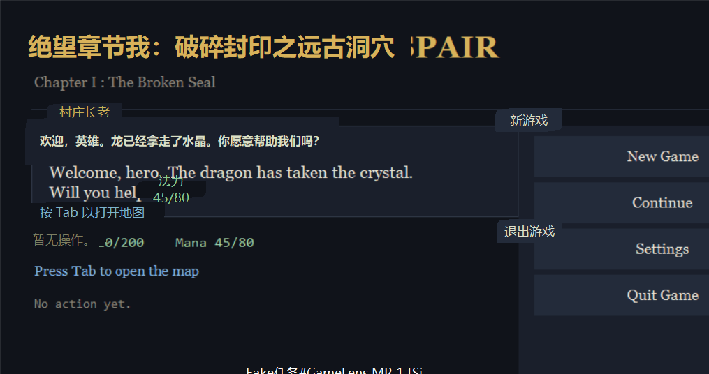

# GameLens · 游戏界面实时汉化工具

[](LICENSE)
[](https://www.python.org/)
[](#)
[](https://github.com/KukaNo996/translation-game/releases/latest)
[](https://github.com/KukaNo996/translation-game/actions)

把**英文 / 日文**游戏界面实时变成中文，**不修改游戏文件、不打断操作**：
汉化层是独立的点击穿透窗口，你在原按钮位置点下去，游戏照样收到点击。

- **离线可用**：内置中英 / 英文 / 日文三套识别模型 + 内置翻译词表，断网也能跑
- **三种模式**：屏幕选区、全屏、进程内存注入（直接改写游戏内部文本）
- **两种语言**：英→中、日→中；也能接 Ollama / DeepSeek 等大模型做高质量翻译
- **不抢焦点**：窗口带 `WS_EX_TRANSPARENT | WS_EX_NOACTIVATE`，鼠标键盘全部穿透



> 交付物：`release/GameLens.exe`（单文件，双击即用，无需安装 Python）
> 源码运行 / 自行打包见文末「从源码运行」。

---

## 三种模式

| 模式 | 适用场景 | 原理 | 是否影响操作 |
| --- | --- | --- | --- |
| **屏幕选区汉化** | 对话框、任务提示、字幕条 | 框选一块区域 → 截图 → OCR → 翻译 → 叠加层原位绘制 | **不影响**，完全穿透 |
| **全屏汉化** | 整屏都是文字的游戏 | 同上，范围是整块屏幕 | **不影响**，完全穿透 |
| **内部注入式汉化** | 文字由 CPU 绘制的游戏 | 遍历目标进程可写内存 → 按 UTF-16LE/UTF-8/GBK 找到文本缓冲区 → 写入译文 | 游戏自己渲染中文 |

### 为什么"汉化了还能继续玩"

叠加层窗口带三个 Windows 扩展样式（`src/gamelens/overlay.py` + `winapi.py`）：

- `WS_EX_TRANSPARENT` — 鼠标事件整块穿透到下层游戏窗口；
- `WS_EX_NOACTIVATE` — 永不抢焦点，键盘输入照常进游戏；
- `WS_EX_LAYERED + LWA_COLORKEY` — 只有文字与色块不透明，其余像素完全透明。

所以它不是"盖住"游戏，而是"贴"在游戏上面的一层玻璃。
实测验证脚本 `tests/smoke_overlay.py` 会用 `WindowFromPoint` 在叠加层覆盖的
多个采样点上查询，命中的都是游戏窗口而不是叠加层本身。

### 注入模式的工作方式

```
游戏进程可写内存区
      │  VirtualQueryEx 遍历（只取 MEM_COMMIT + 可写页，结果缓存 5 秒）
      ▼
同一个内存块只读一次，按三种编码（UTF-16LE / UTF-8 / GBK）一起找原文字节
      │  命中过的内存区排在最前（字符串几乎总在同一片堆里，第二次搜索几毫秒就中）
      ▼
命中 → 读缓冲区容量 → 译文编码后长度 ≤ 容量 → 写入（不足补空格，绝不越界）
游戏下一帧从这块缓冲区读字符串 → 直接渲染出中文
```

- 停止汉化时会把所有写入位置**自动还原**成原文；
- 默认开启**演练模式**（只定位、不写入），日志会告诉你找到了几处可写副本；
- 演练模式关闭时会弹风险确认；
- 找不到缓冲区（GPU 纹理文字、加密文本、Unicode 动态拼接）时，日志会说明原因，
  并可退回叠加层显示——两种手段互补。

#### 注入模式这次做了什么（都是实测数据）

| 指标 | 优化前 | 优化后 |
| --- | --- | --- |
| 查一条文本（真实游戏进程，2.9 GB 可写内存） | 2812 ms / 扫 1200 MB | **710 ms / 扫 250 MB** |
| 查一条文本（命中区优先之后） | — | **20~70 ms / 7~26 MB** |
| 重复查同一条 | 重新全扫 | **0 ms（缓存）** |
| 写进游戏的条数（假游戏 3 条文本） | 5 处 | 7 处，且全部能干净还原 |

具体做法：

- **一遍扫完三种编码**：旧版每种编码各扫一遍全进程可写内存（上限 1.2 GB），
  一条对话就能把流水线卡住好几秒；现在同一个内存块只读一次，三条 needle 一起找，
  读取量直接砍到 1/3。
- **命中区优先 + 内存区快照**：游戏字符串几乎总在同一个堆区，
  上次命中过的区下次排到最前面，第二次搜索从 2.8 秒降到几十毫秒；
  `VirtualQueryEx` 的遍历结果缓存 5 秒，不再每查一条就重走一遍页表。
- **双预算兜底**：单次搜索 256 MB / 500 ms 封顶，找不到就如实返回"未找到"，
  绝不为了找一条文本把主循环拖死；30 秒内不会为同一条文本重复全扫。
- **UTF-16 优先**：旧版三种编码混在一起取前 N 个命中，
  常常被源码/常量里的 ASCII 副本抢满名额，真正的宽字符缓冲区反而搜不到。
  现在按编码分配配额（UTF-16 主配额、单字节编码少量配额），同地址只保留一条。
- **只认 NUL 收尾的 C 字符串**（单字节编码）：往源码常量块里写中文会破坏
  程序自己的数据，也会让还原变脏；这一条把无效写入挡在外面。
- **容量上限 = 原文长度 × 3**：字符串常量常常紧挨着别的常量，
  一旦把隔壁的 0 当成自己的结束符就会越界改写别人的数据。


---

## 翻译引擎

界面上可随时切换，立即生效，全部走同一套缓存与术语表。

| 引擎 | 说明 |
| --- | --- |
| **LiteMT 内置离线引擎** | 词表（约 2200 条游戏高频词/短语）+ 40 条句型模板 + 缩写展开 + 主谓/否定/疑问模板 + 词形还原 + 中英混排润色。零依赖、零网络、单条 < 1ms，作为默认与断网兜底。 |
| **日文专用离线引擎** | 选「游戏语言 = 日文」时自动启用：日语词表（约 500 条界面/对话高频词）+ 助词处理 + 30 余条活用句型（〜てください / 〜ています / 〜たい / 〜ません…）+ 句末动词提前（ご飯を食べる → 吃米饭）。 |
| **Ollama 本地大模型** | `http://127.0.0.1:11434/v1`，如 `qwen2.5:7b-instruct`，离线也有大模型质量。 |
| **OpenAI 兼容 API** | DeepSeek / 通义 / 硅基流动 / 自建 vLLM / One-API / LM Studio，只改 base_url + model。 |
| Google 免费端点 | 免密钥，用来快速验证效果。 |
| DeepL / 百度 | 填 API Key（百度需 appid + 密钥）。 |

**语言支持**：界面里的「游戏语言」决定 OCR 模型与翻译方向。

| 选项 | OCR 模型 | 翻译 |
| --- | --- | --- |
| 英文（识别率最高） | PP-OCRv4 英文识别模型（内置 7.6 MB） | 英→中 |
| 日文 | PP-OCRv4 日文识别模型（内置 9.7 MB） | 日→中 |
| 自动（中英混排） | PP-OCRv3 中英模型 | 英→中 |

日文实测（MS Gothic 40px）：`ゲームを開始する→开始游戏`、`セーブデータ→存档`、
`この扉を開けてください→请打开门`、`私はあなたを愛しています→我爱你`，
8 行整屏识别 192 ms。

联网引擎有三层保护：**批量请求**（一次最多 12~16 条）、**本地缓存**
（`GameLensData/translation_cache.json`，同一句只翻一次）、
**失败自动降级**到 LiteMT，界面不会突然空白。

术语表在译文产出后做替换，用来钉死人名、技能名、道具名。

---

## 快速开始（三步）

1. 双击 `release/GameLens.exe`（注入模式建议右键以管理员身份运行）。
   把游戏切到**窗口化**或**无边框全屏**（独占全屏下任何叠加层都看不到）。
2. 在下拉框选中游戏窗口 → 点 **「锁定游戏窗口」**：汉化区域自动对齐游戏画面，
   之后拖动/缩放游戏窗口，译文层会跟着走。
   同时在 **「游戏语言」** 里选对语种（英文 / 日文 / 自动）：它决定用哪套识别模型和
   翻译方向，选错了识别质量会明显下降。
3. 点 **「试试看」**：真的跑一帧（截图→OCR→翻译→上屏），把
   「识别到什么 → 翻成什么」列出来。看到中文对照正常，再点「开始汉化」持续运行。

> 「试试看」就是用来回答"汉化到底生效没有"的那个按钮：它不做任何假动作，
> 走的是正式运行的完整链路，跑几秒自动停，并把最近一条译文回填到右侧
> **「最近一条译文」** 卡片里。

快捷键：`F8` 选区开关 · `F9` 全屏开关 · `F10` 停止并还原 · `F11` 重新框选 · `F12` 显示/隐藏译文。

### 本机实测的"真实生效"证据

`tests/verify_live.py` 会启动一个真实的假游戏窗口（`tools/fake_game.py`），
跑完整流水线，并做三件真人会做的事：

| 验收点 | 实测结果 |
| --- | --- |
| 译文真的画在原文字位置上 | `tests/assets/proof_region.png`（12 条全部汉化） |
| 叠加层不挡点击 | 覆盖点 `WindowFromPoint` 命中的是**游戏进程**的窗口 |
| 点汉化后的按钮，游戏有反应 | 点击「新游戏」→ 游戏写回 `New Game #1` 的点击日志 |
| 全屏模式 | 整屏识别 12 条，`proof_fullscreen.png` |
| 注入模式真的改了游戏内存 | 目标进程内存中检出 7 条中文译文；画面由游戏自己渲染（`proof_inject.png`） |
| 停止后干净还原 | 内存里中文消失、画面回到英文（`proof_restored.png`） |

**环境自检**（不打开界面，8 秒出结果，报告写在 `GameLensData/selftest.txt`）：

```bash
release\GameLens.exe --selftest
```

本机实测：Win32/DPI、Tk、点击穿透叠加层、Windows 原生 OCR、RapidOCR 离线模型、
OCR 合并流水线、LiteMT 离线翻译、翻译服务与缓存、进程内存注入 —— 9 项全部 PASS。

`tests/verify_live.py` 另跑 11 项真机断言，全部 PASS（含"点汉化后的按钮游戏有反应"、
"注入后内存里检出 7 条中文"、"停止后内存还原"）。

---

## 目录结构

```
src/gamelens/
  winapi.py      Win32 封装：DPI 感知、点击穿透、窗口枚举、进程内存读写
  capture.py     抓屏 / 抓窗口（PrintWindow）、帧变化检测、文字框配色采样
  ocr.py         OCR 双引擎（Windows 原生 / RapidOCR 离线）+ 语种模型选择 + 词→行→段合并
  translate/
    lite.py      LiteMT 离线引擎（模板 + 词表 + 缩写展开 + 主谓句型 + 形态还原）
    lexicon.py   内置词表（英文）
    lexicon_extra.py  按真实语料频次补的扩词表（英文）
    ja.py        日文 → 中文离线引擎（词表 + 助词 + 活用句型 + 语序调整）
    api.py       OpenAI 兼容 / Google / DeepL / 百度
    __init__.py  引擎管理、语种分流、缓存、术语表、降级
  overlay.py     点击穿透叠加层（色键透明 + 原位绘制 + 字号归一）
  selector.py    全屏框选器
  injector.py    进程内存扫描与文本替换、还原
  pipeline.py    截图→OCR→翻译→渲染/注入 三线程流水线（含变化区横带重扫）
  hotkeys.py     全局热键
  app.py         界面
assets/models/   PP-OCRv4 日文/英文识别模型 + 字符表（打包进 exe）
tests/           端到端验证脚本
tools/           bench_game.py（真实游戏基准/上屏验收）、bench_translate.py（汉化覆盖率）、
                 extract_corpus.py（从游戏资源抽语料）、fake_game.py、make_icon.py
build.spec       PyInstaller 打包配置
```

## 从源码运行 / 重新打包

```bash
pip install -r requirements.txt
python src/main.py                       # 直接运行
```

### 打包与发版（自动化）

```bash
python tools/make_release.py                     # 一键出包：清理 → PyInstaller → 自检 → zip → SHA256
python tools/make_release.py --skip-build        # 不重打包，只做自检/压缩/校验和
python tools/make_release.py --upload github     # 出包并上传 GitHub Release（读 GITHUB_TOKEN）
python tools/make_release.py --upload all        # GitHub + Gitee 都传（GITEE_TOKEN + GITEE_OWNER）
```

产物：

| 文件 | 说明 |
| --- | --- |
| `release/GameLens.exe` | 单文件主程序（已内置中英/英文/日文 OCR 模型） |
| `release/GameLens-v<版本>-win64.zip` | 主程序 + 说明书，便于分发 |
| `release/SHA256SUMS.txt` | 校验和 |

脚本内置三道保险：exe 小于 30MB 直接中止（模型没打进去）、
自检会在**干净的配置目录**里跑（不受开发者本机在线翻译服务配置影响）、
上传前逐个文件算 SHA256。

**完全自动发版**：仓库已配置 `.github/workflows/release.yml`，
打个标签就会自动在 GitHub 的 Windows runner 上构建并发 Release，不需要本地任何令牌：

```bash
git tag v1.0.0
git push origin v1.0.0
```

也可以在 Actions 页面手动触发（只构建 + 产出 artifact，不建 Release）。
受限于单文件 100MB 上限，`GameLens.exe` 只作为 **Release 附件**分发，不进 git。

> 版本号唯一来源是 `src/gamelens/__init__.py` 的 `__version__`，
> 改版本只改这一处，窗口标题、zip 名、Release 标签都跟着走。

## 验证

```bash
python tests/verify_live.py            # 真机验收（源码版）：选区/全屏/注入 三模式
python tests/verify_exe.py             # 真机验收（打包版）：给 exe 按 F8/F10，核对上屏与退出
python tests/smoke_overlay.py          # 静态图渲染 + 配色采样
python tests/smoke_inject.py           # 注入细节：定位 → 写入 → 回读 → 还原

# 真实游戏（不是假窗口）
python tools/bench_game.py --exe "<游戏exe路径>" --pipeline --seconds 14
python tools/bench_game.py --exe "<游戏exe路径>" --verify   --seconds 45
python tools/bench_game.py --exe "<游戏exe路径>" --lang ja --pipeline   # 日文游戏
python tools/bench_translate.py --tag after                 # 汉化覆盖率（真实语料）
python tools/bench_translate.py --tag before --legacy       # 改动前的同一套语料，用于对比
```

`verify_exe.py` 是关键的一条：它不调用任何内部函数，只是把打包好的 exe 启动、
按一下 F8、截图、按一下 F10、再截图、关窗，最后检查进程有没有退干净。
本机实测 5/5 PASS：界面打开 3.5s、F8 后画面 5.9% 像素变化（汉化层上屏）、
F10 后回到原样、关窗 1.0s 内进程退出。

`verify_live.py` 自己拉起假游戏、自己点按钮，最后打印 PASS/FAIL 清单，
并把 `proof_region.png / proof_fullscreen.png / proof_inject.png / proof_restored.png`
写进 `tests/assets/`，可以逐张肉眼核对。

## 性能与画质取舍

> 下面的数字不是估算，是拿**真实英文游戏**（Unity/IL2CPP，1920×1080 真窗口）跑出来的，
> 复现命令：`python tools/bench_game.py --exe "<游戏exe>" --pipeline --seconds 14`

| 指标 | 优化前 | 优化后 |
| --- | --- | --- |
| 单帧 OCR（中位，主菜单稳态） | 733 ms | **261 ms** |
| 12 秒内出图帧数 | 16 | **24** |
| 内置引擎"完全汉化"率（1200 条真实文本） | 0.5% | **32.5%** |
| 内置引擎"完全没翻出来"占比 | 31.9% | **1.4%** |

> 复现命令：`python tools/bench_game.py --exe "<游戏exe>" --pipeline --warmup 32 --seconds 12`
> （`--warmup` 是等游戏进主界面再开始计时，避开加载动画的干扰）

做法：

- **认准语言再选引擎**：旧版只要系统装了任意 OCR 包就用 Windows OCR。这台机器只装了
  简体中文包，拿它读英文会把 `Memory` 认成 `Memo「y`、`Setting` 认成 `6uas`，
  再送去翻译就是半英半中的乱码。现在按「游戏语言」匹配语言包，不匹配直接用离线模型，
  运行中还有一道兜底：连续两帧把英文认成汉字就自动换引擎。
- **关掉角度分类器、检测边长按长边缩到 960**：游戏界面不可能出现倒着的字，
  分类器纯浪费（实测每帧白吃 330 ms）；检测模型只负责"框在哪"，文字仍从原图裁剪识别，
  所以缩小检测边长不掉精度，反而把 `6uas` 认回了 `Setting`。
- **只重扫变化区，而且按横带切**：旧版算出一个大包围盒就整块重扫，背景一有粒子动画
  覆盖率就超 45%，直接退回整屏识别。现在按"变动的横带"分别识别，对话框更新只重扫那一条。
- **修掉裁错区的老 bug**：帧差返回的是 `(x, y, w, h)`，旧代码直接丢给
  `Image.crop()`（它要的是 `left, top, right, bottom`），于是裁的是错位区域，
  偶尔还会抛 `Coordinate 'right' is less than 'left'`。这一处同时影响速度和识别准确率。
- **补足词表，而不是堆模板**：拿游戏 exe 里抽出的 4000 条真实文本当语料，统计
  "引擎翻不出来的词"按频次排序，再按排名补条目（`translate/lexicon_extra.py`）。
  最大的一类是缩写（`don't / I'm / you're`，占出现次数前几名），所以先做缩写展开，
  再叠主谓/否定/疑问模板：`I don't know` → `我不知道`。
- **直接抓目标窗口**：默认用 `PrintWindow(PW_RENDERFULLCONTENT)` 抓游戏窗口，
  而不是抓屏 —— 既不会被别的窗口遮挡，也不会把自己刚画的译文再抓进去
  （否则 OCR 会读到中文，越翻越乱）。
- **全屏模式**没有单一窗口可抓，会临时把叠加层藏 20ms 再截屏，
  这是目前唯一会让叠加层闪一下的路径。
- **字体统一**：同一帧按"中等行高"统一换算字号，避免 OCR 框高低不一时
  译文忽大忽小；特别高的标题仍按自身高度放大。
- **窗口自适应**：界面按内容实际需要定尺寸，125%/150% 缩放下也不会把卡片挤出屏幕。
- **关窗即退出**：关掉主窗口会先还原注入、落盘配置与缓存，再结束进程；
  不会留下后台残留（残留进程会占住 exe，导致下次无法覆盖升级）。

### 真机验收（真实游戏，不是假窗口）

`tools/bench_game.py --verify` 会拉起真游戏、开真界面、开真叠加层，跑一帧再截图：

```
叠加层画出 5 条译文：['开始游戏', '读取游戏', '记忆', '设置', '展厅']
译文区域像素变化 18.37%
```

同一帧的 OCR 对照（左＝原画面，右＝汉化后）：

```
Game Start   →  开始游戏
Game Load    →  读取游戏
Memory       →  记忆
Setting      →  设置
Showroom     →  展厅
```

## 已知限制

- **独占全屏**游戏会独占画面输出，叠加层无法显示；请改窗口化/无边框。
- OCR 依赖字体清晰度：极小字号、艺术字、强描边效果识别率会下降。
- Windows 原生 OCR 需要对应语言包；语言包与「游戏语言」不匹配时会自动改用内置离线模型
  （打包时已内置中英/日文/英文三套模型，离线可用）。
- **日文翻译是规则引擎**：界面用语、菜单、短句质量可用；长篇对话只能做到"读懂大意"，
  专有名词与口语语气会失真。日文长文本建议切到 Ollama / DeepSeek 等大模型引擎，
  那时日文 OCR 结果会直接送进大模型，质量最好。
- 注入模式对 UTF-8/GBK 缓冲区严格按原文字节数写入：译文比原文长会跳过并记日志，
  这是为了不越界破坏相邻内存；UTF-16 缓冲区按容量写入，基本都能放下。
- 注入模式只能改写"内存里的明文字符串"；贴图文字、加密文本、动态拼接文本
  无法注入，这类情况请用叠加层。
- 修改运行中游戏的内存存在崩溃风险，请先备份存档，并先用演练模式确认。

## 隐私与安全

- 默认引擎完全离线，不产生任何网络请求；
- 只有你主动选择联网引擎并触发翻译时，才会把**识别到的界面文本**发往你配置的接口；
- API Key 只保存在本地 `GameLensData/config.json`；
- 注入模式只写目标进程，停止即还原，不驻留、不注入 DLL。

## 致谢

- OCR 推理：[RapidOCR](https://github.com/RapidAI/RapidOCR)（ONNX Runtime + PP-OCR 模型）
- 识别模型：PaddleOCR 的 PP-OCRv4 中英 / 英文 / 日文识别模型
- 界面与叠加层：Python 标准库 `tkinter` + Win32 API（`ctypes`），无第三方 GUI 依赖

## 许可证

[MIT](LICENSE) © 2026 Zhu Shang

## 免责声明

- 本项目仅用于**个人学习与本地化辅助**。游戏文本、图像、商标的版权归各自权利人所有，
  本项目不提供、不分发任何游戏资源。
- 请仅对自己合法拥有的游戏使用；因使用本工具产生的任何后果由使用者自行承担。
- 注入模式会改写运行中游戏的内存，存在崩溃风险：请先备份存档，并先用演练模式确认。
- 请勿将本工具用于绕过反作弊、破解付费内容或其它违反游戏服务条款的用途。
